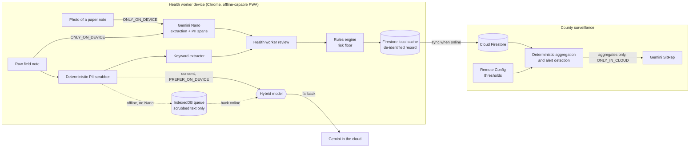

# OutbreakPulse

**Patient data stays on the device. Population intelligence lives in the cloud.**

OutbreakPulse is an offline-first web app for outbreak reporting, built for the #BuildHybridAI 2026 hackathon with the Firebase AI Logic hybrid inference SDK.

**Live app: https://outbreakpulse.web.app** (free, one-click guest sign-in)

Community health workers write messy field notes full of names, phone numbers and locations. Those notes are re-typed into forms days later, and they cannot be uploaded as-is without exposing patients. OutbreakPulse turns a raw note into a structured, de-identified case record **on the device**, with Gemini Nano, even with no connection. The county surveillance team then gets deterministic cluster signals and a cloud-drafted situation report built from aggregate counts only.

> Decision support for trained health workers, not a diagnosis. All data in this repository and in the demo is fictional.

## The problem

Cholera kills within hours, so the first suspected cases have to reach the district fast. In practice, reports travel on paper or are re-typed late:

- During the 2018 cholera outbreak in the South West Region of Cameroon, average timeliness of routine disease surveillance (IDSR) reporting was **16.3%**. The authors concluded that routine data could not provide early warning of that outbreak because reports were incomplete and late ([PMC9903268](https://pmc.ncbi.nlm.nih.gov/articles/PMC9903268/)).
- Field notes carry names, phone numbers and household locations. Uploading them as-is to a cloud model is not acceptable, and re-typing them is the delay.

OutbreakPulse targets the step between the note and the report: structure it in seconds on the phone, remove identifiers before anything leaves, and classify it with the public case definitions the county team already uses.

## Why hybrid inference is the core of the product

The app routes each piece of data by **sensitivity**, not just by model availability:

| Data | Where it is processed | Firebase AI Logic mode |
|---|---|---|
| Raw field note (contains PII) | Gemini Nano, on the device | `ONLY_ON_DEVICE`, so the SDK can never fall back to the cloud with identifiable text |
| Photo of a paper note | Gemini Nano multimodal, on the device | `ONLY_ON_DEVICE`. A photo cannot be scrubbed before sending, so it has no cloud path at all |
| De-identified note | Gemini Nano if available, cloud otherwise | `PREFER_ON_DEVICE` |
| Aggregate counts per sub-county | Cloud | `ONLY_IN_CLOUD` |

A deterministic rules engine sits under all of this. It sets the clinical risk floor instantly, online or offline, with or without AI. AI can raise the level with a stated reason, never lower it.

The **System** page has a live ledger of everything this app sent off the device during the session, with the exact content, next to the AI calls that stayed on it. A judge can check the privacy claim instead of trusting it.

## Architecture



### Field note pipeline

1. **Scrub** (always, local): phone numbers, emails, IDs, coordinates, dates of birth, addresses, titled names and capitalised names are removed by [`redact.ts`](src/lib/triage/redact.ts). A photo of a paper note is transcribed on the device first, then follows the same path.
2. **Route** ([`pipeline.ts`](src/lib/triage/pipeline.ts)):
   - Gemini Nano available: the raw note goes to the `ONLY_ON_DEVICE` model, which extracts the case and lists extra PII strings to remove.
   - No Nano, online: the health worker sees the exact de-identified text and approves sending it to the `PREFER_ON_DEVICE` model.
   - No Nano, offline: the keyword extractor pre-fills the form, and the scrubbed text is queued for AI review when the connection returns.
3. **Review**: the health worker corrects the pre-filled fields.
4. **Rules** ([`rules.ts`](src/lib/triage/rules.ts)): danger-sign rules set the risk level and recommended actions, and the case is classified against the GTFCC suspected cholera definitions ([GTFCC surveillance guidance, 2024](https://www.gtfcc.org/wp-content/uploads/2024/04/public-health-surveillance-for-cholera-guidance-document-2024.pdf)):
   - no outbreak declared in the sub-county: a person aged 2 years or older with acute watery diarrhoea and severe dehydration, or dying of it;
   - outbreak declared by the county team: any person with acute watery diarrhoea, or dying of it.

   The declaration changes the classification only, never the clinical risk level. It is read from the local Firestore cache, so it applies offline too.
5. **Save**: the de-identified record is written to Firestore without awaiting the server, so saving works offline and syncs later.

### Surveillance pipeline

1. Cases are aggregated per sub-county and per day ([`aggregate.ts`](src/lib/surveillance/aggregate.ts)).
2. Alert status (normal, watch, critical) is computed deterministically from Remote Config thresholds ([`detect.ts`](src/lib/surveillance/detect.ts)). Changing a threshold in the Firebase console updates open dashboards in real time. The GTFCC cholera alert is fixed: 2 or more people aged 2 or older with acute watery diarrhoea and severe dehydration, or dying of it, in the same sub-county within the window raise it to at least watch.
3. The dashboard shows a schematic county map coloured by status and an epidemic curve by onset day, split into suspected cholera and other cases ([`epicurve.ts`](src/lib/surveillance/epicurve.ts)). Selecting a sub-county filters the curve. From the same table the county team declares or ends an outbreak per sub-county.
4. Only the aggregate table is sent to the `ONLY_IN_CLOUD` model to draft the situation report ([`tasks.ts`](src/lib/ai/tasks.ts)). The dashboard shows the exact payload sent.

## Measured, not claimed

The **Evidence** page runs a labelled set of fictional field notes through each tier and scores it in the browser. There are two sets: a development set of 24 notes used while building the scrubber and extractor, and a held-out set of 12 notes written separately and never used for tuning. The held-out set is the default.

| Held-out set (12 notes, 26 identifiers) | Deterministic tier (offline) | Hybrid, cloud path (no Nano) |
|---|---|---|
| Identifiers removed before any AI call | 25 of 26 | 25 of 26 (same scrubber) |
| Danger-sign F1 | 0.63 | 0.95 |
| Field accuracy | 75% | 94% |
| Under-triaged cases | 2 | 0 |
| Latency, median and p95 | instant | 1 726 ms, 3 141 ms |

On the development set the deterministic tier removes 40 of 40 identifiers. The one held-out identifier the scrubber missed is left in on purpose: it is why the cloud path shows the health worker the exact de-identified text before sending, and why the raw note itself only ever goes to an `ONLY_ON_DEVICE` model. The deterministic numbers are pinned in [`evaluate.test.ts`](src/lib/eval/evaluate.test.ts). The on-device (Gemini Nano) column can be measured on the Evidence page in Chrome with Nano enabled.

## Where Firebase is used

| Service | Usage | Code |
|---|---|---|
| Firebase AI Logic (`firebase/ai`) | Gemini Developer API or Agent Platform backend, four model instances (raw note, photo, scrubbed note, SitRep), structured JSON output on device (`responseConstraint`) and in the cloud (`responseSchema`), `inferenceSource` and latency shown on every result | [`models.ts`](src/lib/ai/models.ts), [`tasks.ts`](src/lib/ai/tasks.ts), [`schemas.ts`](src/lib/ai/schemas.ts) |
| App Check | reCAPTCHA Enterprise (invisible score) in production, debug provider locally. Enforced for AI Logic | [`app.ts`](src/lib/firebase/app.ts) |
| Authentication | One-click anonymous guest session | [`auth.ts`](src/lib/firebase/auth.ts) |
| Cloud Firestore | Persistent local cache, offline writes, pending-sync state, outbreak declarations read offline, strict security rules with a field allowlist | [`firestore.ts`](src/lib/firebase/firestore.ts), [`firestore.rules`](firestore.rules) |
| Remote Config | Alert thresholds, windows, SitRep model and privacy gate, with real-time updates | [`remote-config.ts`](src/lib/firebase/remote-config.ts) |
| Hosting | Static export with a generated service worker | [`firebase.json`](firebase.json), [`generate-sw.mjs`](scripts/generate-sw.mjs) |

## Testing guide for judges

1. Open https://outbreakpulse.web.app and click **Continue as guest**. Each guest session is an isolated workspace.
2. On **Overview**, click **Load demo cases**, then open **Surveillance**: Riverside is critical with a cholera alert, and Market Hill is on watch. Click Riverside on the map to filter the epidemic curve. Click **Generate SitRep** and expand "Show exactly what was sent to the cloud".
3. Click **Declare** next to Riverside. Field reports from Riverside now use the outbreak case definition.
4. Open **Field report**, click a sample note, then **Analyze note**:
   - With Gemini Nano: the badge shows **On-device** with latency, and the privacy panel shows that nothing was sent to the cloud. **Try a sample photo** reads a handwritten note on the device.
   - Without Gemini Nano: the app asks for consent and shows the exact de-identified text before calling the cloud.
5. Go offline (DevTools > Network > Offline). Write and save another report: it is analyzed by the rules engine and appears in **Cases** as **Pending sync**. Go back online: it syncs, and the queued AI review runs automatically.
6. Open **System**: "What left this device" lists every request with its content. Raw notes and photos never appear there. The same page shows the state of every service and lets you download Gemini Nano.
7. Open **Evidence** and run the deterministic tier, then the hybrid tier, on the held-out set.

### Enable Gemini Nano in Chrome

On-device inference needs Chrome on desktop, version 139 or later.

1. Open `chrome://flags/#prompt-api-for-gemini-nano-multimodal-input` and set it to **Enabled**.
2. Restart Chrome.
3. Open the **System** page and click **Download Gemini Nano**. The download can take several minutes.

If the button does not appear, the System page explains why: browser version, Prompt API not exposed (flag inactive or Chrome not relaunched), or a device below Chrome's requirements. In the last case, also set `chrome://flags/#optimization-guide-on-device-model` to **Enabled BypassPerfRequirement**. `chrome://on-device-internals` shows the model download state.

Without Gemini Nano the app keeps working: it falls back to the cloud for de-identified text and to the rules engine when offline.

## Local setup

Requirements: Node.js 24, a Firebase project on the Spark (free) plan, Chrome 139+.

```bash
npm install
cp .env.example .env.local
```

1. In the Firebase console, create a project and register a **Web app**. Copy its config into `.env.local`.
2. **AI Services > AI Logic > Get started** and pick a cloud backend, then set `NEXT_PUBLIC_AI_BACKEND` to match:
   - `gemini-developer`: **Gemini Developer API**, works on the Spark plan (free tier or AI Studio credits).
   - `agent-platform`: **Agent Platform Gemini API** (formerly Vertex AI), billed to the Blaze plan. The hosted demo uses this one.

   On-device inference is identical with both.
3. **Security > App Check**: create a **reCAPTCHA Enterprise** score key for your Hosting domains, register it for the web app, and put it in `NEXT_PUBLIC_RECAPTCHA_ENTERPRISE_SITE_KEY` (a classic reCAPTCHA v3 key also works through `NEXT_PUBLIC_RECAPTCHA_V3_SITE_KEY`). Production values go in `.env.production.local`, which overrides `.env.local` during `next build`. For local development keep `NEXT_PUBLIC_APPCHECK_DEBUG=true`, run the app once, copy the debug token printed in the browser console and add it under **Manage debug tokens**.
4. **Build > Authentication**: enable the **Anonymous** provider.
5. **Build > Firestore Database**: create a database, then deploy rules and indexes:

   ```bash
   firebase use --add
   firebase deploy --only firestore
   ```

6. Optional, **Remote Config**: create the parameters below to override the defaults.

| Key | Default |
|---|---|
| `cluster_window_days` | `7` |
| `cluster_baseline_days` | `14` |
| `cluster_watch_threshold` | `3` |
| `cluster_critical_threshold` | `6` |
| `sitrep_model` | `gemini-3.8-flash` |
| `privacy_gate_required` | `true` |

Run:

```bash
npm run dev
```

Production build and deploy:

```bash
npm run build
firebase deploy --only hosting
```

The service worker is only registered in production builds. To test offline mode locally, run `npm run build` then `firebase emulators:start --only hosting` and open `http://localhost:5000`.

## Quality

```bash
npm run check   # lint, typecheck, unit tests, production build
```

Unit tests cover the PII scrubber, the rules engine and the GTFCC case definitions, risk merging, the routing decision (including a test that the raw note can never reach the hybrid model), aggregation, alert detection, the epidemic curve, the egress ledger, the evaluation scores and the demo dataset.

## Project structure

```
src/app/            routes: overview, triage, cases, surveillance, evidence, system
src/components/     shared UI, county map, epidemic curve, egress ledger
src/lib/ai/         Firebase AI Logic models, prompts, schemas, device detection
src/lib/triage/     scrubber, keyword extractor, rules engine, pipeline (pure)
src/lib/surveillance/ aggregation, detection, epidemic curve, SitRep input (pure)
src/lib/eval/       labelled development and held-out notes, scoring (pure)
src/lib/egress/     in-memory ledger of what left the device
src/lib/firebase/   app + App Check, auth, Firestore, Remote Config
src/lib/offline/    deferred AI review queue
scripts/            service worker generator
```

## Built during the submission period

The entire project was created during the #BuildHybridAI 2026 submission period (November 2026). Development used Claude Code as a coding assistant. Third-party code is limited to the open source dependencies listed in `package.json`.

## License

[Apache License 2.0](LICENSE)
